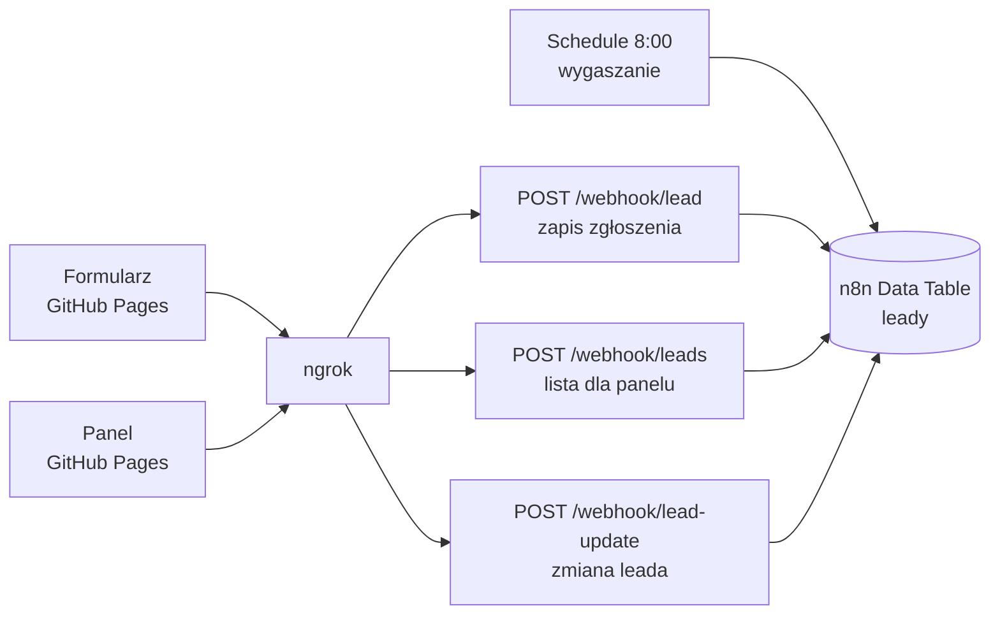

# Lead Inbox – mini-CRM dla firmy od termomodernizacji

Formularz zgłoszeń dla klienta i panel leadów dla handlowca. Backend to n8n, bez własnego serwera aplikacji. TermoDom to fikcyjna marka na potrzeby demo.

**Demo**
- Formularz: https://jansolo04.github.io/lead-inbox/form/
- Panel: https://jansolo04.github.io/lead-inbox/panel/ → przycisk **„Zobacz demo”** (przykładowe dane, gdy mój komputer z n8n jest wyłączony)
- Nagranie: _link do nagrania_

## Co robi

- **Formularz**: imię, telefon, e-mail, miasto, produkty (pompa ciepła, ocieplenie, okna, fotowoltaika, inne), opis, zgoda RODO. Walidacja po obu stronach, honeypot na boty.
- **Panel**: liczniki (nowe / gorące / wystygłe), tabela z gorącymi leadami na górze, filtry, wyszukiwarka, karta leada z linkiem `tel:`, zmiana statusu, przypisanie handlowca, notatki. Dostęp na token.
- **Temperatura leada**: nowy lead jest „gorący” przez 7 dni. Jeśli nikt się nie odezwał (status dalej „nowy”), automat codziennie o 8:00 zmienia go na „zimny”.
- **Statusy**: nowy → w kontakcie → audyt → oferta → wygrany / przegrany.

## Architektura



| Warstwa | Technologia |
| --- | --- |
| Frontend | czysty HTML, CSS, JavaScript, GitHub Pages |
| Backend | n8n w Dockerze (4 workflowy) |
| Baza | n8n Data Tables |
| Publiczny adres | ngrok (stała darmowa domena) |

## Decyzje i problemy po drodze

- **Data Tables zamiast Google Sheets**: zero konfiguracji OAuth, aktualizacja po `id` jednym węzłem, dane zostają lokalnie.
- **Tylko „proste” zapytania z przeglądarki**: n8n zwracał 500 na preflight `OPTIONS`, więc strony wysyłają `POST` jako `application/x-www-form-urlencoded`, bez własnych nagłówków. Token idzie w treści żądania.
- **Wszystko jako POST**: na darmowym planie ngrok `GET` z przeglądarki trafia na stronę ostrzegawczą (`ERR_NGROK_6024`).
- **Temperatura liczona też przy odczycie**: jeśli komputer był wyłączony o 8:00, endpoint listy i tak zwraca poprawną temperaturę.
- **Tryb demo w panelu**: gdy backend nie odpowie w 6 s, panel pokazuje przykładowe dane, więc demo działa zawsze.
- **Bezpieczeństwo na poziomie demo**: token wpisywany ręcznie (nie ma go w repo), escapowanie HTML przy wyświetlaniu, czyszczenie i limity długości po stronie n8n, biała lista statusów.

## Zbudowane z Claude Code

Projekt powstał w parze z Claude: od planu i architektury, przez kod workflowów n8n i obu stron, po debugowanie CORS (preflight, strona ostrzegawcza ngrok) na podstawie błędów z konsoli i odpowiedzi `curl`. Moja rola: decyzje (zakres, baza, statusy), konfiguracja n8n, Dockera i ngrok, testy i poprawki.

## Struktura repo

```
lead-inbox/
├── config.js          # adres n8n (API_URL)
├── form/index.html    # formularz klienta
├── panel/index.html   # panel pracownika + tryb demo
└── n8n/               # eksporty workflowów (JSON, bez tokena)
```

## Uruchomienie u siebie

1. n8n w Dockerze: `docker run -d --name n8n -p 5678:5678 -v n8n_data:/home/node/.n8n -e GENERIC_TIMEZONE=Europe/Warsaw docker.n8n.io/n8nio/n8n`
2. W n8n utwórz Data Table `leady` z kolumnami: `data, imie, telefon, email, miasto, produkt, opis, temperatura, goracy_do, status, handlowiec, notatki` (wszystkie typu string).
3. Zaimportuj workflowy z `n8n/`, w węzłach `IF token` wpisz swój token zamiast `TOKEN`, aktywuj.
4. Wystaw n8n przez ngrok (`ngrok http 5678 --url=twoja-domena.ngrok-free.dev`) i wpisz adres w `config.js`.
5. Włącz GitHub Pages dla repo (branch `main`, root).
